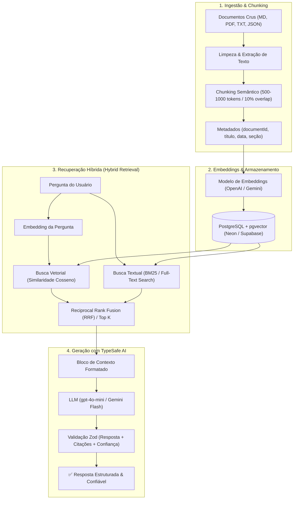

# 🧠 RAG Architecture Patterns (`rag-architecture-patterns`)

Este manual estabelece as convenções obrigatórias para implementar e operar sistemas de **RAG (Retrieval-Augmented Generation)** em **qualquer projeto ou sistema** (Web SaaS, APIs, CLIs, automações internas ou bases de conhecimento de agentes).

---

## 🎯 1. Quando Aplicar RAG em um Projeto

Use RAG sempre que o sistema precisar:
1. **Responder perguntas sobre dados proprietários:** Documentação interna, contratos, histórico de chamados, wikis ou dados do cliente.
2. **Eliminar alucinações:** Limitar a resposta da LLM estritamente a trechos recuperados de fontes auditáveis.
3. **Superar limites de janela de contexto:** Consultar bases de milhares ou milhões de páginas gastando frações de centavos por requisição.
4. **Semântica + Precisão Cirúrgica:** Combinar busca vetorial (compreensão de sinônimos/ideias) com busca exata (siglas, erros de código, nomes).

---

## 🏛️ 2. Arquitetura Padrão Ouro (Os 5 Módulos)



---

## 🪚 3. Princípios Ponytail Mandatórios (Anti-Overengineering)

1. **Reaproveite o Banco Existente:**
   - Se o projeto já tem PostgreSQL, use **`pgvector`** (nativo no Neon e Supabase). Não contrate ou suba clusters dedicados como Pinecone/Milvus antes de ultrapassar 500.000 chunks.
   - Se for um app desktop ou CLI local, use **SQLite com FTS5** ou extensões vetoriais locais.
2. **Evite Abstrações Complexas:**
   - Um script simples de ingestão (`ler arquivo ➔ chunk ➔ embed ➔ INSERT SQL`) é mais confiável e manutenível do que 10 bibliotecas encadeadas com pipelines opacos.
3. **Chunking com Propósito:**
   - Respeite as fronteiras naturais do documento (títulos `#`, `##` e quebras de parágrafo). Nunca corte texto de forma puramente arbitrária por quantidade de caracteres.

---

## 🛡️ 4. Contrato de Resposta TypeSafe AI

Toda chamada de RAG deve retornar uma estrutura fortemente tipada:

```typescript
import { z } from 'zod';

export const RagResponseSchema = z.object({
  answer: z.string().describe('Resposta fundamentada unicamente no contexto fornecido.'),
  confidence: z.enum(['high', 'medium', 'low']).describe('Nível de certeza com base na clareza do contexto.'),
  citations: z.array(z.object({
    source: z.string().describe('Identificador do documento ou arquivo.'),
    excerpt: z.string().describe('Trecho exato do contexto que valida a resposta.')
  })).min(1).describe('Fontes consultadas que comprovam a resposta.'),
  missingInformation: z.string().optional().describe('Lacunas que a pergunta pediu mas não constam na base.')
});

export type RagResponse = z.infer<typeof RagResponseSchema>;
```

---

## 📚 5. Aplicação no Projeto de Skills (`SkiilsToIAs`)

No próprio repositório `SkiilsToIAs`:
- **Base de Conhecimento:** 685 skills, 26 MCPs e manuais de custom-agents.
- **Como o RAG Funciona Aqui:**
  1. Cada arquivo `SKILL.md` ou manual de MCP é indexado com seus metadados (nome, categoria, descrição).
  2. Ao pedir *"como fazer X"*, a busca híbrida encontra instantaneamente as 3 melhores skills e os MCPs necessários sem carregar 700 arquivos na janela de contexto.
  3. Reduz o consumo de tokens em **mais de 90%**, tornando qualquer orquestração instantânea e de baixo custo.
