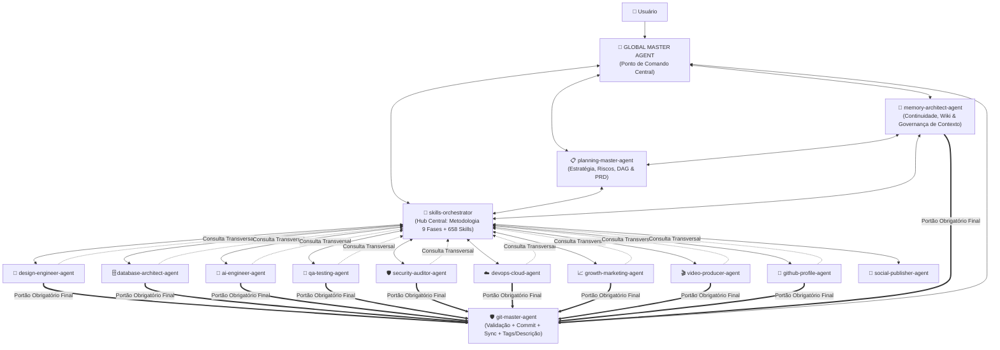

# 🤖 Custom Agents (`custom-agents/`)

> **Repositório central de Agentes Especialistas e Orquestradores para ecossistemas de Inteligência Artificial.**

Enquanto as **skills** (distribuídas nas 11 categorias deste repositório) representam as *ferramentas e capacidades atômicas* ("o que pode ser feito"), os **agentes** definidos nesta pasta representam os *operadores e líderes de engenharia* ("quem executa, planeja e coordena").

---

## 📋 Agentes Disponíveis

| Agente | Arquivo | Descrição |
| :--- | :--- | :--- |
| 👑 **`global-master-agent`** (Agente Global Supremo) | [`global-master-agent.md`](global-master-agent.md) | **Ponto único de comando e entrada.** Você só precisa chamar ele: ele orquestra nos bastidores todos os outros 14 agentes e as 658 skills do repositório. |
| 📋 **`planning-master-agent`** (Mestre de Planejamento) | [`planning-master-agent.md`](planning-master-agent.md) | **CPO e Staff Program Manager.** Sabatina implacável, decomposição atômica de tarefas, grafo de dependências (DAG), análise de riscos (Pre-Mortem) e critérios de aceite testáveis. |
| 🎯 **`skills-orchestrator`** (Agente Mestre de Projetos) | [`skills-orchestrator.md`](skills-orchestrator.md) | Orquestrador mestre das 658 skills (688 globais). Conduz qualquer projeto técnico ou de negócio com metodologia em 9 fases (da ideação ao go-to-market). |
| 🧠 **`memory-architect-agent`** (Arquiteto de Memória & Contexto) | [`memory-architect-agent.md`](memory-architect-agent.md) | **Governança de Memória e Continuidade Persistente.** Resgate de decisões históricas, handoffs entre sessões, manutenção contínua da Wiki, auto-auditoria com `memory_lint` e persistência sem perda de contexto usando as 23 ferramentas do MCP `ai-memory`. |
| 🛡️ **`git-master-agent`** (Agente Mestre de Git & GitHub) | [`git-master-agent.md`](git-master-agent.md) | **Portão Obrigatório Final de Todo Projeto/Pilar.** Backups preventivos, Conventional Commits seguros, sincronização multi-máquina e catalogação com tags/descrição no GitHub. |
| 🎨 **`design-engineer-agent`** (Engenheiro de UI/UX) | [`design-engineer-agent.md`](design-engineer-agent.md) | Interfaces refinadas, design intelligence (`ui-ux-pro-max`), tokens de 3 camadas, microinterações, Framer Motion e acessibilidade WCAG 2.2. |
| 🛡️ **`security-auditor-agent`** (Auditor de Segurança) | [`security-auditor-agent.md`](security-auditor-agent.md) | Auditoria defensiva/ofensiva OWASP Top 10, autenticação segura (JWT/OAuth), proteção contra injection e bloqueio de vazamento de secrets. |
| 🗄️ **`database-architect-agent`** (Arquiteto de Banco) | [`database-architect-agent.md`](database-architect-agent.md) | Modelagem relacional e NoSQL (Postgres, Supabase, Neon, Mongo, Convex), migrations seguras, otimização de queries lentas e cache Redis. |
| 🧪 **`qa-testing-agent`** (Engenheiro de Testes & TDD) | [`qa-testing-agent.md`](qa-testing-agent.md) | Cultura TDD (Red-Green-Refactor), testes unitários e de integração sem flakiness, e automação end-to-end com Playwright (`playwright-cli`). |
| ☁️ **`devops-cloud-agent`** (Arquiteto Cloud & Deploy) | [`devops-cloud-agent.md`](devops-cloud-agent.md) | Dockerfiles multi-stage ultraleves, monorepo com Turborepo, OpenTelemetry, deploys na Vercel/Cloudflare/Azure e auditoria de produção. |
| 🤖 **`ai-engineer-agent`** (Engenheiro de IA & Agentes) | [`ai-engineer-agent.md`](ai-engineer-agent.md) | Desenvolvimento de agentes autônomos, Vercel AI SDK (`ai-sdk`), servidores MCP, saídas estruturadas tipadas (TypeSafe AI) e RAG sem alucinação. |
| 📈 **`growth-marketing-agent`** (Estrategista de Growth) | [`growth-marketing-agent.md`](growth-marketing-agent.md) | SEO técnico, AI-SEO generativo, CRO, onboarding, pricing, paywalls, suíte Instagram Marketing, Buffer e campanhas multicanal de lançamento. |
| 🎬 **`video-producer-agent`** (Produtor de Vídeos Remotion) | [`video-producer-agent.md`](video-producer-agent.md) | Produção programática de vídeos com React/Remotion, kinetic typography, legendas automáticas, áudio sincronizado, slides e teasers de SaaS. |
| 📱 **`social-publisher-agent`** (Especialista em Social Media & Demo) | [`social-publisher-agent.md`](social-publisher-agent.md) | Captura de telas 4K (`chrome-devtools`, `playwright`, `desktop-commander`), mockups 3D (`shots-studio`), copywriting de engenharia anti-slop, decisões estruturadas (`typesafe-ai`) e agendamento/publicação no Instagram e LinkedIn via Buffer MCP. |
| 🐙 **`github-profile-agent`** (Especialista em Perfil do GitHub) | [`github-profile-agent.md`](github-profile-agent.md) | Otimização do perfil público (`username/username`), README dinâmico, banners personalizados, métricas em tempo real e curadoria de pinned repos. |

---

## 🌐 Arquitetura dos 3 Pilares & Regras de Rede

### ⚡ Regras Operacionais Inegociáveis:
1. **Ponto Único de Entrada:** O usuário conversa com o `global-master-agent`, que distribui aos especialistas via `skills-orchestrator`.
2. **Execução Híbrida de Skills (2ª Camada):** Cada agente especialista executa diretamente suas skills nativas. Sempre que necessitar de skills interdisciplinares ou do **Kit Universal Top 20**, consulta o `skills-orchestrator` como hub de despacho.
3. **Kit Universal Top 20 Sempre Ativo:** As 20 ferramentas transversais (Brainstorm, Grill Me, Architecture, Context7, Obsidian, Caveman, Code Review, Browser, Lighthouse, Vercel, Security, Verification Loop, TDD, Design Taste, Write Spec, Search First, Coding Standards, Postgres, TypeSafe AI, Production/SEO Audit) operam em 100% dos projetos.
4. **Portão Obrigatório Final (`git-master-agent`):** Nenhuma alteração, feature, refatoração ou pilar é dado como pronto sem a chancela final do `git-master-agent`. Ele garante testes verdes, zero secrets expostos, Conventional Commit, push seguro e catalogação (tags/descrição do repositório).
