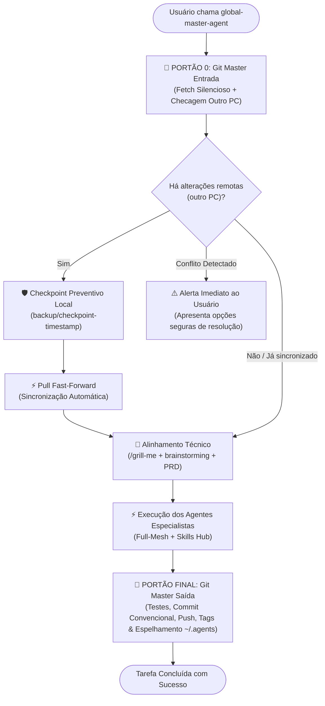

# ADR-002: Arquitetura Double-Gate do Git Master Agent (Portão 0 de Entrada & Portão Final de Saída)

- **Status:** Aceito
- **Data:** 2026-10-24
- **Autor:** Henrique Bezerra dos Santos (`@Henrique1601`) & AI Agentic Architecture
- **Contexto:** Trabalho contínuo multi-máquina (PC Trabalho ↔ PC Pessoal) gerenciado pelo `global-master-agent`.

---

## 1. Contexto e Problema

O ecossistema `SkiilsToIAs` opera com 14 agentes customizados, 643 skills e 25 servidores MCP sob comando central do `global-master-agent`. O usuário desenvolve código em mais de um ambiente (PC Pessoal e PC de Trabalho), além de eventuais alterações diretas no GitHub.

Anteriormente (ADR-001), o `git-master-agent` atuava estritamente como **Portão Obrigatório Final** ao término da tarefa. Isso gerava um risco operacional: se o usuário iniciasse uma nova tarefa no PC Pessoal enquanto o PC de Trabalho já havia comitado e empurrado alterações para o GitHub, o agente começava a planejar e codificar em cima de uma base desatualizada, aumentando o risco de conflitos de merge e retrabalho.

---

## 2. Decisão Arquitetural: Arquitetura "Double-Gate" (Livro-Aberto)

Fica estabelecido que o fluxo de vida de **qualquer solicitação recebida pelo `global-master-agent`** adota o padrão **Double-Gate**:

### 🚪 Portão 0 (Entrada - Verificação & Sincronização Inicial):
1. **Fetch Silencioso & Transparente:**
   - Ao ser invocado, o `global-master-agent` aciona o `git-master-agent` para executar `git fetch origin` em segundo plano.
2. **Avaliação de Divergência:**
   - Compara `HEAD` contra `origin/<branch>`.
3. **Sincronização Segura:**
   - Se houver commits no GitHub originados do outro PC:
     - Gera uma branch de checkpoint preventiva: `git branch backup/checkpoint-$(date +%Y%m%d_%H%M%S)`.
     - Aplica `git pull --ff-only origin <branch>`.
     - Notifica o usuário de forma limpa: *"Sincronizado com X commits recentes do outro PC"*.
   - Se houver divergência ou conflito local, o agente **para** imediatamente e expõe a situação antes de iniciar código.
4. **Alinhamento Imediato:**
   - Com a base local 100% fresca, inicia a etapa de entrevista e refinamento de requisitos via `/grill-me`.

### 🚪 Portão Final (Saída - Fechamento & Governança):
1. **Auditoria de Segurança:** `security-review` (ausência de `.env` ou secrets).
2. **Verificação de Qualidade:** `verification-loop` (build e testes verdes).
3. **Metadados:** Atualização de tags, descrição no GitHub (`gh repo edit`) e releases se houver binários.
4. **Commit & Push:** Conventional Commit semântico atômico e push remoto.
5. **Espelhamento Obrigatório:** Execução do **Protocolo 7** para manter `C:\Users\henri\.agents\custom-agents` e `~/.gemini/config/` perfeitamente sincronizados.

---

## 3. Consequências

- **Positivas:**
  - Eliminação de conflitos de merge decorrentes de código desatualizado entre máquinas.
  - Segurança total: nenhum pull ou alteração ocorre sem um snapshot prévio de checkpoint.
  - O usuário sempre discute requisitos (`/grill-me`) sobre a versão mais recente do projeto.
- **Governança:**
  - Ambas as pontas do ciclo de desenvolvimento passam a ser vigiadas pela autoridade máxima do `git-master-agent`.
