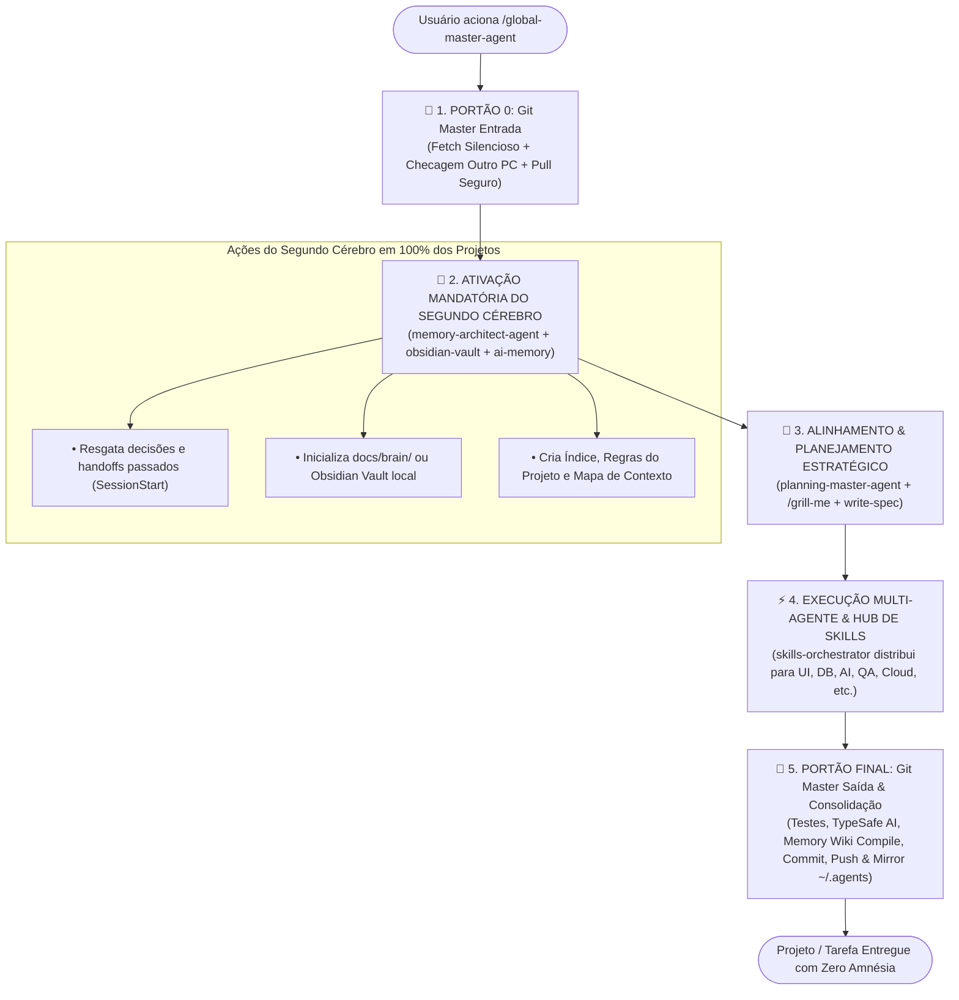

# ADR-004: Pipeline Mandatório do Global Master Agent com Ativação Automática do Segundo Cérebro e Mesa Diretora

- **Status:** Aceito
- **Data:** 2026-10-30
- **Autor:** Henrique Bezerra dos Santos (`@Henrique1601`) & AI Agentic Architecture
- **Contexto:** Garantir que o `global-master-agent` seja o ponto único de comando absoluto, acionando automaticamente o `memory-architect-agent` (Segundo Cérebro: `ai-memory` + `obsidian-vault`) em 100% dos projetos iniciados ou continuados, sem exigir nenhuma chamada manual do usuário.

---

## 1. Contexto e Problema Identificado

O usuário relatou uma falha de governança no ecossistema: ao chamar `/global-master-agent` para iniciar ou conduzir um projeto, ele esperava que **todo o ecossistema de especialistas fosse acionado de forma coordenada nos bastidores**, especialmente o **`memory-architect-agent`** para instituir o **Segundo Cérebro (*Second Brain*)** do projeto. 

Contudo, o `memory-architect-agent` não foi ativado automaticamente, obrigando o usuário a invocá-lo manualmente. 

### Causa Raiz:
1. No fluxo da seção 4 do `global-master-agent.md`, os agentes `planning-master-agent`, `memory-architect-agent` e `skills-orchestrator` constavam no diagrama Full-Mesh, mas a especificação textual dizia apenas *"invoque os agentes correspondentes"*, deixando a ativação do Segundo Cérebro implícita e condicional.
2. Não havia uma **Fase 1 Mandatória de Inicialização do Segundo Cérebro** que criasse o diretório de notas/wiki do projeto e conectasse o grafo de persistência logo após o Portão 0 do Git Master.

---

## 2. Decisão Arquitetural: O Pipeline Obrigatório em 5 Fases do `global-master-agent`

A partir de agora, **toda e qualquer solicitação direcionada ao `global-master-agent`** aciona automaticamente e sem exceção a seguinte esteira integrada:

---

## 3. Especificação das Fases Mandatórias

### 🧠 Fase 2: Ativação Obrigatória do Segundo Cérebro (`memory-architect-agent`)
Logo após o Portão 0 do Git Master confirmar que a branch local está sincronizada com o outro PC/GitHub, o `global-master-agent` invoca **imediatamente** o `memory-architect-agent` para:
1. **Resgate Histórico (`SessionStart`):** Executar busca via `memory_query` / `memory_handoff_accept` para verificar se já existem decisões anteriores sobre este projeto.
2. **Scaffold do Segundo Cérebro Local:**
   - Garantir a existência do diretório estruturado de conhecimento:
     - `docs/brain/INDEX.md` (Índice central de wikilinks `[[...]]`).
     - `docs/brain/DECISIONS.md` (Histórico de decisões arquiteturais e regras).
     - `docs/brain/GOTCHAS.md` (Armadilhas conhecidas e soluções de bugs anteriores).
   - Integração com `obsidian-vault` e MCP `ai-memory` para sincronização semântica.
3. **Injeção de Contexto Vivo:** O mapa de contexto é repassado diretamente para a fase de planejamento.

### 🎯 Fase 3: Planejamento Estratégico (`planning-master-agent`)
- Executa a entrevista interativa `/grill-me` (via `ask_question`).
- Decomposição em DAG de tarefas atômicas, análise de riscos (*Pre-Mortem*) e PRD enxuto.

### ⚡ Fase 4: Orquestração e Hub de 678 Skills (`skills-orchestrator`)
- Delega a execução técnica para os agentes especialistas conforme a stack (Design, Database, Backend, Cloud, QA, etc.).
- Enforce mandatório do **TypeSafe AI** em todas as saídas de inteligência artificial.

### 🚪 Fase 5: Portão Final de Fechamento (`git-master-agent` + `memory-architect-agent`)
1. Execução do `verification-loop` (testes e build verdes).
2. O `memory-architect-agent` consolida a memória da sessão (`memory_write_memo` + `memory_wiki_compile` + atualização de `docs/brain/`).
3. Commit semântico atômico, push remoto, catalogação de tags/releases no GitHub.
4. Espelhamento automático para `~/.agents/custom-agents` e `~/.gemini/config/` (Protocolo 7).

---

## 4. Consequências

- **Experiência Única para o Usuário:** O usuário só precisa digitar `/global-master-agent`. Todos os 15 agentes trabalham sincronizados nos bastidores.
- **Segundo Cérebro Universal:** Todo projeto ganha nativamente persistência, rastreabilidade e memória histórica durável contra amnésia operacional.
- **Governança Absoluta:** O ciclo é fechado tanto na entrada (Git Master) quanto na saída (Git Master + Memory Architect).
